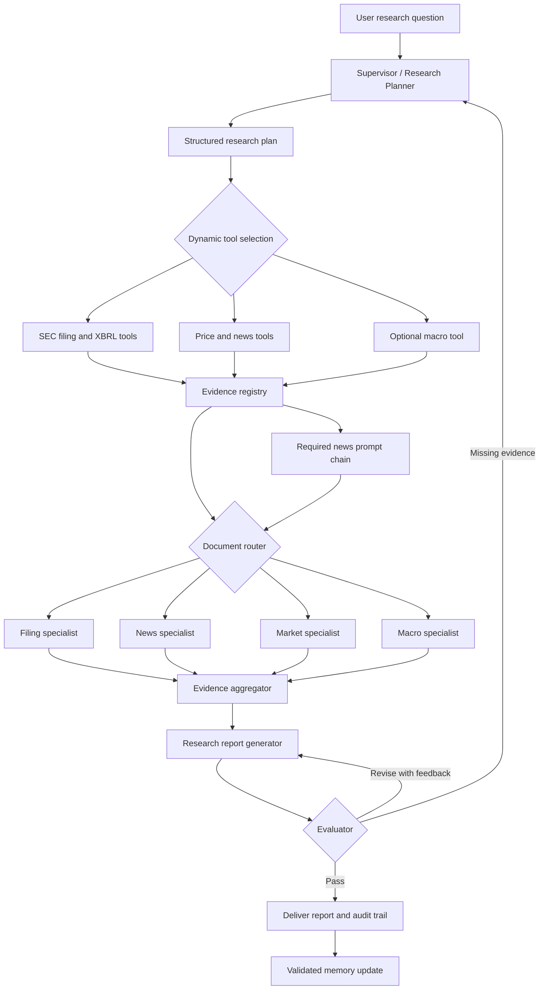

# Final Project Plan: FAANG+M Narrative-to-Numbers Research Desk

## 1. Executive Decision

Build a reproducible multi-agent investment research system named **FAANG+M Narrative-to-Numbers Research Desk**. The system will analyze Meta, Apple, Amazon, Netflix, Alphabet, and Microsoft and answer a focused question:

> Are each company's AI and growth narratives supported by reported financial execution, filing disclosures, independent news, and the market's reaction?

The project will not attempt to predict exact future stock prices or issue automatic buy/sell instructions. Instead, it will produce an evidence-backed comparative research brief, divergence alerts, source citations, confidence levels, and a full audit trail showing how the agents planned, selected tools, routed work, reflected, revised, and learned between runs.

This direction is distinctive because it measures gaps between several kinds of evidence rather than producing another sentiment dashboard:

- **Management narrative:** AI, cloud, advertising, devices, streaming, and efficiency claims in 10-K, 10-Q, and 8-K filings.
- **Financial execution:** revenue, operating income, research and development, capital expenditures, operating cash flow, and free cash flow.
- **Independent narrative:** recent news topics and financial sentiment.
- **Market confirmation:** benchmark-adjusted returns around filing dates and recent risk/return behavior.
- **Narrative tension:** positive claims that coexist with rising risk language, deteriorating cash conversion, or negative market reaction.

The primary final artifact will be one executed, professional HTML notebook. The repository will also contain modular Python code, tests, cached data snapshots, generated tables/charts, a README, references, and an explicit AI-use disclosure.

## 2. Requirements and Rubric Translation

The target is **355/355 points**: 120 points for workflow patterns, 120 points for agent functions, and 115 points for code and deliverable quality. Every required capability will have visible input, intermediate state, output, evaluation, and interpretation in the notebook.

| Rubric area | Points | Required implementation evidence |
| --- | ---: | --- |
| Prompt chaining | Included in 120 | A visible `Ingest News -> Preprocess -> Classify -> Extract -> Summarize` run with saved stage outputs and stage gates |
| Routing | Included in 120 | Mixed documents dynamically routed to filing, news, market, or macro specialists; route decisions and reasons logged |
| Evaluator-optimizer | Included in 120 | Draft report scored against a structured rubric, rejected with feedback when needed, revised, and rescored |
| Plans research steps | Included in 120 | The supervisor produces a query-specific structured plan rather than always running a fixed sequence |
| Uses tools dynamically | Included in 120 | The plan selects only required SEC, price, news, retrieval, or macro tools and records every call |
| Self-reflects | Included in 120 | The evaluator identifies unsupported claims, stale/missing data, numeric conflicts, and imbalance before accepting output |
| Learns across runs | Included in 120 | Persistent memory stores validated source/tag preferences and evaluator lessons; a second run demonstrates measurable reuse |
| Code notebook | 115 | Readable executed HTML/PDF, useful comments, visualizations, GitHub link, PEP 8 modules, clean outputs, and reproducible setup |

## 3. Scope

### 3.1 Company universe

Use the classic FAANG companies plus Microsoft, labeled consistently as **FAANG+M**.

| Company | Ticker used | SEC CIK | Role in comparison |
| --- | --- | --- | --- |
| Meta Platforms | META | 0001326801 | Advertising and AI infrastructure |
| Apple | AAPL | 0000320193 | Devices, services, and on-device AI |
| Amazon | AMZN | 0001018724 | Commerce, AWS, and AI infrastructure |
| Netflix | NFLX | 0001065280 | Streaming, advertising, and recommendation technology |
| Alphabet | GOOGL | 0001652044 | Search, cloud, advertising, and foundation models |
| Microsoft | MSFT | 0000789019 | Azure, Copilot, enterprise software, and AI infrastructure |

`GOOGL` will be used for price analysis; SEC facts apply to Alphabet as the reporting entity. Netflix remains in scope even though it differs from the hyperscalers because it creates a useful contrast between AI-enabled product operations and infrastructure-heavy AI investment.

### 3.2 Time scope

- Financial trends: the latest three complete fiscal years available at the frozen data date.
- Filing narratives: latest 10-K plus latest 10-Q available at the frozen data date.
- Current-event context: approximately 90 days of news ending at the frozen data date.
- Market context: one year of daily adjusted prices ending at the frozen data date.
- Event analysis: trading days around the filing dates used in the report.
- Macro context: the latest available observations as of the frozen date, used only when the user asks for macro sensitivity or the planner judges it material.

The collector will save `retrieved_at`, `source_updated_at` when available, period start/end, filing date, accession number, URL, and content hash. The executed notebook will use the frozen snapshot so future reruns remain auditable even if live APIs change.

### 3.3 Core user queries and invocation budget

| Invocation type | Count | Query/scope | Purpose |
| --- | ---: | --- | --- |
| End-to-end graph | 1 | Cold-memory FAANG+M comparison | Produce the comparative report and establish baseline tool/retry/quality measures |
| End-to-end graph | 1 | Warm-memory repeat of the identical query and frozen evidence | Demonstrate learning while holding inputs constant |
| Planner-only probe | 1 | "Assess Microsoft's AI investment narrative, financial capacity, major risks, and recent market confirmation." | Prove query-specific planning for a given stock symbol |
| Planner/router-only probe | 1 | "Compare META and GOOGL regulatory-news risk without running a full valuation analysis." | Prove that unrelated financial and macro tools are omitted |

**Total end-to-end graph executions: exactly 2.** The two probes do not collect data, invoke specialists, synthesize reports, or enter the evaluator loop. This design supports one or many symbols while avoiding five separate end-to-end executions.

### 3.4 Core limits and stretch boundaries

Keep the required path deliberately bounded so the notebook runs reliably on a laptop:

- Analyze at most the latest 10-K and 10-Q plus one earnings-related 8-K per company in the core run.
- Process up to 10 recent news items per company, limited to items available within the 90-day window. Report sparse coverage rather than silently extending the window.
- Retrieve at most six filing chunks for any one specialist call.
- Load one shared local controller model, one FinBERT classifier, and one embedding model; agent roles are prompts and graph nodes, not six duplicate model copies.
- Allow one evidence-request loop and two report revisions.
- Follow the invocation budget in Section 3.3; do not add another end-to-end execution to the required path.

Core scope includes SEC financials and filings, Yahoo price/news metadata, all required workflows, all four agent functions, evaluation, and a reproducible report.

FRED integration is optional stretch work, as are a cross-encoder reranker, filing-language diffs beyond two periods, valuation multiples, and a user interface. Stretch work begins only after the rubric checklist passes.

**Go/no-go gate:** no stretch item may start before the two full runs succeed and the notebook contains one visible demonstration for each of the four agent functions and three required workflows. If that gate is not met by October 4, all stretch work is canceled.

## 4. Research Questions and Testable Hypotheses

The system will organize evidence around research questions, not around a predetermined winner.

1. Which companies increased capital spending and research investment while preserving operating and free-cash-flow margins?
2. How strongly do companies emphasize AI and related themes in their latest filings, normalized per 10,000 words?
3. Are AI-related statements supported by nearby quantitative evidence or only qualitative language?
4. Does independent news sentiment agree with the tone of company disclosures?
5. Did the market react in the same direction as the dominant filing/news narrative after major filing events?
6. Which apparent divergences are genuine, and which arise from different fiscal calendars, reporting definitions, or missing tags?

Example hypotheses to evaluate:

- **H1:** Greater AI narrative intensity does not necessarily imply stronger free-cash-flow support.
- **H2:** Positive news sentiment and positive management tone can coexist with a negative benchmark-adjusted filing-date reaction.
- **H3:** Primary-source retrieval and deterministic numeric checks reduce unsupported financial claims after evaluator feedback.
- **H4:** Memory of successful company-specific XBRL tag mappings reduces data-retrieval retries on a second run.

These are hypotheses for analysis, not assumptions encoded into the scoring logic.

## 5. Data-Source Research and Acquisition Strategy

### 5.1 Source hierarchy

Use sources in this order:

1. **SEC EDGAR filing text and XBRL facts:** authoritative source for reported company data.
2. **Company-filed 8-K exhibits:** primary earnings releases and presentations when available through EDGAR.
3. **Yahoo Finance through `yfinance`:** convenient market-price and news metadata source recommended by the assignment.
4. **FRED:** optional macro context such as policy rates, Treasury yields, inflation, and recession indicators.
5. **Model-generated synthesis:** never treated as a source; every material claim must point to collected evidence.

### 5.2 SEC EDGAR

The SEC's `data.sec.gov` APIs require no API key and provide real-time JSON for company submissions and standardized XBRL facts. The project will use:

- `https://data.sec.gov/submissions/CIK##########.json`
- `https://data.sec.gov/api/xbrl/companyfacts/CIK##########.json`
- Filing documents under `https://www.sec.gov/Archives/edgar/data/...`

The collector will send a descriptive `User-Agent`, remain well below the SEC's published maximum of 10 requests per second, retry transient failures with exponential backoff, and cache responses. It will ingest 10-K, 10-Q, and selected 8-K filings. The filing parser will retain accession numbers and section-level evidence IDs.

Candidate XBRL concepts will be resolved from ordered fallbacks and then verified by form, fiscal period, duration, filing date, and unit:

| Metric | Preferred concepts or derivation |
| --- | --- |
| Revenue | `RevenueFromContractWithCustomerExcludingAssessedTax`, then `Revenues`, then company-validated fallback |
| Operating income | `OperatingIncomeLoss` |
| Net income | `NetIncomeLoss` |
| Research and development | `ResearchAndDevelopmentExpense` |
| Operating cash flow | `NetCashProvidedByUsedInOperatingActivities` |
| Capital expenditures | `PaymentsToAcquirePropertyPlantAndEquipment` with disclosed company fallback |
| Free cash flow | Operating cash flow minus capital expenditures; explicitly labeled as a derived non-GAAP analytical measure |

The code will never select a fact solely because it is the latest value. It will filter and deduplicate facts by reporting period and frame, preventing amended or overlapping year-to-date observations from being double counted.

A live feasibility check on September 7, 2026 verified all six ticker-to-CIK mappings and received HTTP 200 responses from all six `companyfacts` endpoints. Revenue, operating income, net income, operating cash flow, capital expenditures, and R&D concepts were present for META, AAPL, NFLX, GOOGL, and MSFT. **Amazon R&D exception:** AMZN alone lacked the exact `ResearchAndDevelopmentExpense` concept. The project will therefore show Amazon's reported technology-related expense separately if a primary filing disclosure can be validated; it will not relabel a superficially similar concept as GAAP R&D or use it in a like-for-like R&D chart.

### 5.3 Market and news data

`yfinance` exposes multi-ticker historical downloads and ticker news metadata. It will be used for:

- Daily adjusted prices for the six stocks and `QQQ` as a transparent technology-heavy benchmark.
- Trading-date alignment for filing event windows.
- Recent news titles, publisher, publication time, summary when supplied, and canonical URL.

Because `yfinance` is an unofficial convenience wrapper, its documentation limits Yahoo data to personal/research use, and live responses may change, the system will cache a dated snapshot and include a fallback fixture containing only the metadata needed to reproduce the notebook. It will not scrape or redistribute full copyrighted articles. The notebook will disclose source limitations and link to Yahoo's terms. A September 7, 2026 smoke test returned a quote and three news records for MSFT, but this verifies availability only at that moment, not a service guarantee.

The first implementation milestone must create and test the fallback fixture, not merely promise it. The fixture manifest will record retrieval date, ticker, row count, schema, content hashes, source URLs, and usage notes. A frozen-mode integration test must pass with network access disabled before agent development is considered complete.

### 5.4 Macro data

FRED is optional rather than a critical dependency because its API requires a user-specific key. When `FRED_API_KEY` is available, the macro tool can retrieve:

- Federal funds target/effective rate context.
- 10-year Treasury yield.
- CPI inflation.
- Recession indicator or real GDP growth.

Without a key, the planner must continue with a logged `macro_context_unavailable` state rather than fail the core analysis. No secret will be committed to GitHub.

### 5.5 Earnings-event definition

Use an earnings-related 8-K release/acceptance timestamp as the preferred event anchor. A later 10-Q or 10-K filing date may not represent when the market first learned the results. If an earnings 8-K cannot be linked confidently, omit that event or label the alternate anchor rather than imply a clean earnings reaction. Record whether the event occurred before, during, or after market hours and map it to the appropriate trading day.

### 5.6 Data contracts

Every collected text item will use a common evidence schema:

```text
evidence_id, company, ticker, source_type, document_type, title,
published_at, period_end, filing_date, accession_number, url,
raw_text_hash, clean_text, retrieved_at
```

Every numeric fact will include:

```text
company, metric, value, unit, period_start, period_end, fiscal_year,
fiscal_period, form, filed_at, accession_number, xbrl_concept,
is_derived, source_url
```

This contract allows the evaluator to trace prose claims back to the exact filing section or numeric fact.

## 6. Proposed System Architecture

Use **LangGraph** for explicit state, conditional routing, bounded loops, and inspectable execution. Its documented design supports mixed deterministic and agentic steps, thread-scoped checkpoints, and cross-thread stores. Use `SqliteSaver` for local graph checkpoints and the validated memory tables for durable lessons. Use specialized prompts and tools within one local model runtime rather than loading a separate large model for every role.



### 6.1 Shared graph state

Define a typed state rather than passing unstructured messages:

```python
class ResearchState(TypedDict):
    query: str
    companies: list[str]
    as_of_date: str
    research_plan: list[PlanStep]
    completed_steps: list[str]
    tool_trace: list[ToolEvent]
    evidence: list[EvidenceItem]
    metrics: list[FinancialFact]
    routes: list[RouteDecision]
    specialist_findings: list[Finding]
    draft_report: ResearchReport | None
    evaluation: EvaluationResult | None
    revision_count: int
    memory_used: list[MemoryRecord]
    warnings: list[str]
```

Pydantic models will validate LLM-produced plans, route decisions, extracted claims, findings, and evaluator output. Invalid JSON gets one schema-repair attempt; persistent failure falls back to a transparent deterministic rule and records that fallback in the trace.

## 7. Agent Roles and Responsibilities

### 7.1 Supervisor / Investment Research Agent

- Interprets the user's goal, companies, horizon, and requested depth.
- Produces a structured sequence of objectives, tools, dependencies, and stop conditions.
- Reads prior validated memory before planning.
- Selects tools dynamically. A news-risk-only query should not automatically run all valuation and macro tools.
- Revises the plan only when a tool fails, required evidence is missing, or the evaluator requests more evidence.
- Stops after bounded attempts and reports unresolved uncertainty.

### 7.2 Filing Specialist

- Retrieves relevant filing sections through semantic search over chunked 10-K/10-Q/8-K text.
- Extracts management claims, quantitative support, risks, catalysts, period references, and evidence IDs.
- Separates company-reported facts from analyst-derived metrics.
- Compares current and prior filing language to identify new, removed, or intensified themes.

### 7.3 News Specialist

- Owns the required five-stage prompt chain.
- Uses FinBERT for financial sentiment probabilities.
- Classifies topics using a constrained taxonomy.
- Extracts event, entities, direction, time horizon, and uncertainty.
- Produces source-linked summaries without inventing article details absent from the ingested title/summary.
- Registers accepted Stage 5 summaries back into the shared evidence registry so routing, synthesis, and evaluation consume the prompt-chain output; the chain is not a disconnected rubric demo.

### 7.4 Market Specialist

- Computes returns, volatility, drawdown, and filing-date event reactions from adjusted prices.
- Uses `QQQ` benchmark-adjusted returns rather than attributing every price move to the company.
- Labels calculations as descriptive, not causal.
- Detects agreement or divergence between narrative tone and observed market reaction.

### 7.5 Macro Specialist

- Runs only when macro context is requested or materially relevant to a claim.
- Retrieves the smallest necessary set of FRED series.
- Adds release dates and freshness warnings.
- Avoids causal claims from simple correlations.

### 7.6 Evidence Synthesizer

- Combines specialist findings into a fixed research-report schema.
- Produces balanced catalysts, risks, divergences, unknowns, and a confidence assessment.
- Adds an evidence ID to every material narrative claim and source metadata to every displayed number.
- Uses "insufficient evidence" rather than filling gaps from model memory.

### 7.7 Evaluator / Optimizer

- Scores the draft with both deterministic checks and an LLM critique.
- Returns `accept`, `revise`, or `request_evidence` plus actionable feedback.
- Rejects unsupported numbers, missing citations, stale evidence, one-sided analysis, contradictions, and overconfident language.
- Allows at most two report revisions and at most one evidence-request loop.

### 7.8 Memory Curator

- Writes only validated, compact lessons after a run is accepted.
- Stores successful company/metric XBRL tag choices, source health, useful query terms, evaluator failure patterns, and final quality scores.
- Never stores an unverified investment conclusion as durable truth.

## 8. Required Workflow Pattern 1: Prompt Chaining

Implement and display the exact required sequence:

```text
Ingest News -> Preprocess -> Classify -> Extract -> Summarize
```

### Stage 1: Ingest News

- Query each requested ticker for the time window.
- Retain metadata, title, supplied summary, URL, and retrieval timestamp.
- Deduplicate by canonical URL and normalized-title hash.
- Gate: valid company mapping, timestamp, title, URL, and nonempty text.

### Stage 2: Preprocess

- Strip HTML artifacts and normalize whitespace without altering numbers.
- Preserve negation, currency, percentages, dates, and named entities.
- Attach ticker aliases such as `GOOG`, `GOOGL`, `Alphabet`, and `Google`.
- Gate: text length and language checks; reject empty or duplicate content.

### Stage 3: Classify

Assign one primary topic and optional secondary topics:

- `earnings_financials`
- `ai_capex_cloud`
- `product_strategy`
- `regulatory_legal`
- `leadership_labor`
- `macro_market`
- `other`

FinBERT separately returns `positive`, `negative`, or `neutral` probabilities. Topic and sentiment remain separate variables.

### Stage 4: Extract

Return structured fields:

```text
companies, event, claims, numeric_mentions, catalyst_or_risk,
time_horizon, sentiment, uncertainty, evidence_id
```

The extraction prompt may use only provided text. Numeric mentions are checked against the source string.

### Stage 5: Summarize

- Produce a concise company/event summary from extracted fields.
- Include evidence IDs and calibrated uncertainty.
- Gate: all cited IDs exist, all copied numbers occur in evidence, and no unsupported entity is introduced.

The notebook will show a stage-by-stage table for at least three articles, including one item that fails a gate or requires schema repair.

## 9. Required Workflow Pattern 2: Routing

The router receives document metadata plus a short excerpt and emits:

```text
route, secondary_route, confidence, reason, required_tools
```

Primary routes:

| Route | Typical input | Specialist output |
| --- | --- | --- |
| `filing` | 10-K, 10-Q, 8-K, earnings exhibit | Claims, metrics, risks, filing changes, citations |
| `news` | News title/summary | Topic, sentiment, event, risk/catalyst, source-linked summary |
| `market` | Price question or event date | Returns, event window, volatility, benchmark comparison |
| `macro` | Rate, inflation, GDP, or economy question | Relevant series, observation, release timing, caveat |
| `mixed` | Cross-source synthesis request | Parallel specialist dispatch followed by aggregation |

Routing is an LLM decision constrained to this enum, with a deterministic metadata-based fallback. The notebook will present a confusion matrix on a manually labeled mixed-document test set and examples where the route changes the downstream tools.

## 10. Required Workflow Pattern 3: Evaluator-Optimizer

### 10.1 Evaluation rubric

Score each draft from 0 to 100:

| Dimension | Weight | Deterministic or judged check |
| --- | ---: | --- |
| Citation coverage and validity | 25 | Every material claim has an existing evidence ID and source URL |
| Numeric consistency | 20 | Displayed numbers reconcile to collected facts/calculations within tolerance |
| Groundedness | 20 | Claims are entailed by cited excerpts; no outside facts introduced |
| Analytical balance | 10 | Both supporting and conflicting evidence are discussed |
| Freshness and period clarity | 10 | As-of date, fiscal periods, filing dates, and stale/missing flags are visible |
| Question coverage | 10 | The report addresses every requested objective |
| Style and uncertainty | 5 | Concise, readable, non-promotional, and appropriately qualified |

Acceptance requires:

- Overall score at least 85.
- Citation coverage at least 95%.
- Numeric consistency of 100% for displayed key metrics.
- No critical unsupported claim.
- No missing answer to a required research objective.

These are internal quality gates, not additional course grading rules. If the bounded loop ends below a target, the system must deliver a clearly marked partial report with failed checks and limitations; the team should still submit an honest, fully demonstrated workflow rather than hide the run.

### 10.2 Bounded optimization loop

1. Generate draft version 1.
2. Run deterministic validators.
3. Run evaluator critique with cited evidence available.
4. If evidence is missing, return one focused task to the supervisor.
5. Otherwise revise the report using the evaluator's itemized feedback.
6. Re-evaluate and retain version-to-version scores.
7. Stop after two revisions; disclose remaining failures rather than loop indefinitely.

The notebook will display a before/after excerpt and score chart proving that feedback changed the report.

## 11. Autonomous Planning and Dynamic Tool Use

The planner will generate a typed plan with:

```text
step_id, objective, agent, candidate_tools, selected_tool,
dependencies, success_criteria, fallback, status
```

Dynamic behavior will be demonstrated with contrasting queries:

- A full comparison selects SEC, news, prices, retrieval, and synthesis.
- A regulatory-news query selects news and filing-risk retrieval but skips unnecessary financial-ratio work.
- A missing FRED key causes a logged fallback, not a fabricated macro result.
- Missing company-specific XBRL concepts trigger known fallback tags from memory, then filing-table extraction if needed.

The tool trace will record tool name, sanitized arguments, start/end time, success, record count, cache status, error type, retry count, and output evidence IDs. Secrets and full prompts containing large copyrighted text will not be logged.

## 12. Learning Across Runs

Use a small SQLite database in `outputs/memory/agent_memory.sqlite` with four logical tables:

| Table | Durable content |
| --- | --- |
| `metric_mappings` | Company, metric, successful XBRL concept, unit, period pattern, validation date |
| `source_health` | Source, last success, failures, average latency, retry recommendation |
| `evaluation_lessons` | Failure category, compact critic lesson, successful correction, count |
| `run_history` | Query hash, data snapshot, tools used, quality score, revisions, completion state |

Memory policy:

- Read memory before planning and tag every reused record in `memory_used`.
- Write only after validator/evaluator acceptance.
- Expire source-health records and revalidate metric mappings against each new filing.
- Keep conclusions run-specific; do not preserve "Company X is best" as a fact.
- Support `--reset-memory` for a clean experiment.

Demonstrate learning using the two end-to-end executions already budgeted in Section 3.3:

1. Run the FAANG+M comparison with empty memory.
2. Record tag-resolution attempts, tool retries, latency, and evaluator issues.
3. Repeat the identical query using validated memory and the same frozen data.
4. Compare successful tag selection on first attempt, cache use, retries, runtime, and final quality.

The learning claim passes only if `memory_used` is nonempty, at least one validated mapping or evaluator lesson changes a later decision, and at least one fallback lookup/retry is eliminated while numeric/report quality remains unchanged or better. If no measured behavior improves, report that result and do not claim learning.

## 13. Financial and NLP Analysis Methods

### 13.1 Financial calculations

For company $i$ and fiscal year $t$:

$$
\text{Revenue Growth}_{i,t} = \frac{\text{Revenue}_{i,t} - \text{Revenue}_{i,t-1}}{\text{Revenue}_{i,t-1}}
$$

$$
\text{Operating Margin}_{i,t} = \frac{\text{Operating Income}_{i,t}}{\text{Revenue}_{i,t}}
$$

$$
\text{FCF}_{i,t} = \text{Operating Cash Flow}_{i,t} - \text{Capital Expenditures}_{i,t}
$$

$$
\text{FCF Margin}_{i,t} = \frac{\text{FCF}_{i,t}}{\text{Revenue}_{i,t}}
$$

$$
\text{Capex Intensity}_{i,t} = \frac{\text{Capital Expenditures}_{i,t}}{\text{Revenue}_{i,t}}
$$

$$
\text{R\&D Intensity}_{i,t} = \frac{\text{R\&D Expense}_{i,t}}{\text{Revenue}_{i,t}}
$$

Fiscal-year endpoint differences will remain visible. The comparison will not silently mix annual and trailing-period facts.

A secondary valuation lens may report market-cap-to-revenue and market-cap-to-FCF using the frozen-date share price and validated shares outstanding. It is optional because point-in-time share counts and fiscal-period alignment must pass validation first; the project will not add a valuation table built from incompatible dates merely for visual completeness.

### 13.2 Market calculations

Use adjusted closing prices and simple daily returns. For filing event date $d$ and benchmark `QQQ`:

$$
AR_{i,t} = R_{i,t} - R_{QQQ,t}
$$

$$
CAR_{i,[d-1,d+1]} = \sum_{t=d-1}^{d+1} AR_{i,t}
$$

If the filing occurs after market close, the event alignment moves to the next trading day. The notebook will also report annualized volatility and maximum drawdown over the common one-year window. Results are descriptive associations, not causal attribution.

### 13.3 Narrative measurements

- AI narrative intensity: AI-related sentence count per 10,000 filing words.
- Quantified-claim rate: share of extracted AI/growth claims containing a source-verified number.
- Risk intensity: risk-topic sentence count per 10,000 words.
- News sentiment: mean FinBERT class probabilities and net sentiment by company/topic.
- Source agreement: whether filing tone, independent-news tone, financial direction, and market reaction have the same sign.

### 13.4 Narrative-to-numbers divergence flags

Use transparent flags rather than an opaque stock score:

- `narrative_funding_pressure`: high/rising AI emphasis and capex intensity with falling FCF margin.
- `optimism_market_gap`: positive filing/news tone with negative benchmark-adjusted event reaction.
- `investment_without_disclosed_monetization`: strong AI/capex language but few source-verified monetization claims.
- `risk_narrative_tension`: positive strategic summary alongside materially rising risk-topic intensity.
- `evidence_gap`: the available sources cannot support a cross-company conclusion.

Thresholds will be declared before inspecting rankings, tested in sensitivity analysis, and accompanied by the underlying values. A flag is a research prompt, not an investment recommendation.

## 14. Model and Retrieval Strategy

### 14.1 Local, reproducible baseline

- Controller/specialist LLM baseline: `Qwen/Qwen2.5-1.5B-Instruct`, which has 1.54 billion parameters, an Apache 2.0 license, a 32,768-token context in the published model configuration, and explicit model-card emphasis on structured/JSON output. Use a current compatible `transformers` release (`>=4.37` is required by the model card), Apple MPS when available, and CPU fallback.
- Financial sentiment: `ProsusAI/finbert`, which returns positive, negative, and neutral probabilities for financial text.
- Embeddings: `sentence-transformers/all-MiniLM-L6-v2`, a 384-dimensional sentence/short-paragraph encoder.
- Vector search: FAISS over section-aware filing chunks.

Before full implementation, run 12 representative prompts covering plans, routes, extraction, synthesis, and revision. The baseline remains selected only if it achieves at least 90% schema-valid output after at most one repair and does not exceed the available memory/runtime budget. If it fails, compare one documented compact alternative using the same prompts rather than changing models informally. The README will pin the selected model revision where practical.

Measure peak resident memory and latency during the first-week smoke test. Process model-heavy stages sequentially: run and cache FinBERT news labels, then release FinBERT; build and persist MiniLM embeddings, then release MiniLM when retrieval is complete; then load Qwen for agent reasoning and synthesis. At float16/bfloat16 precision, 1.54 billion Qwen parameters alone require roughly 3.1 GB for weights before runtime overhead, so model coexistence must not be assumed. If MPS is unavailable or the measured budget is exceeded, reduce batch size and context first; if necessary, run Qwen on CPU and make sentiment optional. Topic classification, routing, and required workflow traces must still run through schema-validated rules/fallbacks rather than crash.

### 14.2 Filing retrieval

- Parse filing sections before chunking so evidence IDs retain section context.
- Chunk near 700-1,000 characters with modest overlap after inspecting length distributions.
- Preserve company, ticker, form, filing date, accession number, section, chunk ID, and URL.
- Use metadata filters so a company-specific query cannot retrieve another company's filing unless comparison is requested.
- Retrieve top candidates with MiniLM and optionally rerank using lexical overlap or a lightweight cross-encoder if runtime permits.
- Display retrieved excerpts and scores for key report claims.

## 15. Evaluation Plan

### 15.1 Gold and audit sets

Create small, human-reviewed evaluation fixtures before final tuning:

| Evaluation set | Proposed size | Measures |
| --- | ---: | --- |
| Mixed-document routing | 40 items | Accuracy, macro F1, fallback frequency |
| News topic classification | 60 headlines/summaries | Per-class precision/recall/F1 and macro F1 |
| News extraction | 30 items | Entity/event/numeric precision, recall, exact numeric support |
| Filing retrieval | 30 questions with known sections | Recall@1, Recall@3, MRR, citation traceability |
| Report claim audit | At least 40 material claims | Citation coverage, citation correctness, numeric consistency |
| Evaluator loop | At least 6 reports/cases | Initial/final score, issue-resolution rate, iterations |
| Memory A/B | At least 2 paired runs | First-attempt tag success, retries, latency, quality preservation |

The manual labels, annotation guide, and disagreements will be saved in the repository. Team members should double-review a subset rather than letting the same LLM create and judge all labels.

Use these fixed **development/held-out test splits**: 40/20 for the 60-item news set, 20/20 for the 40-item routing set, and 10/20 for the 30-question filing-retrieval set. Prompts, thresholds, and fallback rules may be revised using development items only. Report final metrics once on the held-out partitions, while retaining the small sample sizes as an explicit limitation.

### 15.2 Target quality gates

Targets guide iteration but will not be hidden if missed:

- Routing accuracy at least 90% on the held-out set.
- News topic macro F1 at least 0.80, with per-class results shown.
- Filing retrieval Recall@3 at least 0.85 on the curated question set.
- Material-claim citation coverage at least 95%.
- Displayed key-number consistency exactly 100% against the normalized facts table.
- No accepted report containing a critical unsupported claim.
- Evaluator score improves or remains passing after revision.
- Memory-enabled run reduces at least one retry/lookup measure without reducing quality.

### 15.3 Ablations

Run compact comparisons that make the project conclusions defensible:

1. Rule-only routing versus LLM routing with deterministic fallback.
2. Keyword filing search versus MiniLM semantic retrieval.
3. Draft report without evaluator feedback versus optimized report.
4. Cold-memory versus warm-memory plan/tool behavior.
5. News headline-only sentiment versus headline-plus-supplied-summary sentiment when both exist.

### 15.4 Failure taxonomy

Classify every observed failure as one of:

- Source unavailable or stale.
- Filing parse/section failure.
- XBRL concept or fiscal-period mismatch.
- News entity/topic classification error.
- Retrieval miss.
- Routing error.
- Unsupported extraction.
- Synthesis contradiction.
- Evaluator false pass or false reject.
- Memory stale/incorrect reuse.

For each important failure, record evidence, effect on the report, mitigation, and residual risk.

## 16. Notebook Storyboard

The final notebook should read as a research demonstration, not a code dump.

1. Title, team, GitHub link, as-of date, disclaimer, and executive summary.
2. Problem statement: narrative-to-numbers alignment across FAANG+M.
3. Rubric map showing exactly where every requirement is demonstrated.
4. Architecture diagram and agent/state definitions.
5. Environment, package/model versions, device, seeds, and configuration.
6. Data sources, source hierarchy, compliance, snapshots, and provenance.
7. Company universe and raw-data quality checks.
8. SEC metric normalization and three-year financial comparison.
9. Filing ingestion, chunking, embedding, and retrieval evaluation.
10. Required news prompt chain with intermediate outputs.
11. Routing workflow with trace examples and confusion matrix.
12. Autonomous planner and dynamic tool-use demonstrations.
13. Specialist findings and narrative-to-numbers divergence analysis.
14. Evaluator-optimizer before/after demonstration.
15. Cross-run memory A/B demonstration.
16. Final comparative FAANG+M research brief.
17. Quantitative evaluation, ablations, and failure analysis.
18. Limitations, ethics, non-advisory disclaimer, and future work.
19. References and explicit AI-assistance disclosure, repeated in the root `AI_USE_DISCLOSURE.md` and linked from the README.
20. Automated deliverable-integrity checks.

## 17. Recommended Visual Evidence

- Three-year revenue growth, operating margin, FCF margin, capex intensity, and R&D intensity small multiples.
- Filing AI-intensity versus capex-intensity scatterplot.
- News sentiment versus benchmark-adjusted filing reaction quadrant chart.
- Company-by-evidence-dimension narrative alignment heatmap.
- Divergence alert matrix with underlying values and evidence IDs.
- Routing confusion matrix.
- Filing retrieval Recall@k chart.
- Evaluator version 1 versus final score chart.
- Cold-memory versus warm-memory retries/latency chart.
- Tool execution timeline or concise agent trace diagram.

Charts will show period labels, units, sources, and caveats. Cross-company charts will not hide different fiscal year ends.

## 18. Repository and Artifact Layout

```text
Final_Project/
|-- Final_Project.md
|-- plan.md
|-- README.md
|-- requirements.txt
|-- pyproject.toml
|-- .env.example
|-- .gitignore
|-- notebooks/
|   |-- FAANGM_Narrative_to_Numbers.ipynb
|   `-- FAANGM_Narrative_to_Numbers.html
|-- src/
|   `-- faangm_research/
|       |-- __init__.py
|       |-- config.py
|       |-- schemas.py
|       |-- graph.py
|       |-- agents/
|       |   |-- planner.py
|       |   |-- router.py
|       |   |-- specialists.py
|       |   |-- synthesizer.py
|       |   |-- evaluator.py
|       |   `-- memory.py
|       |-- tools/
|       |   |-- sec_edgar.py
|       |   |-- market_news.py
|       |   |-- fred.py
|       |   `-- retrieval.py
|       |-- workflows/
|       |   `-- news_chain.py
|       `-- analytics/
|           |-- financials.py
|           |-- market.py
|           `-- narrative.py
|-- data/
|   |-- raw/.gitkeep
|   |-- processed/.gitkeep
|   `-- evaluation/
|-- outputs/
|   |-- figures/
|   |-- tables/
|   |-- traces/
|   `-- memory/
|-- tests/
|-- CITATIONS.md
`-- AI_USE_DISCLOSURE.md
```

Generated model caches, secrets, large raw downloads, and temporary notebook checkpoints will be ignored. A small frozen snapshot needed for grading reproducibility will be documented and committed only if licensing and repository-size constraints permit.

Install the package in editable mode (`python -m pip install -e .`) before notebook execution. The notebook will import only the package's public APIs and print the package location in its environment section, preventing fragile working-directory imports.

## 19. Implementation Phases and Team Plan

### Phase 1: Scope, contracts, and source proof (Sep 7-13)

- Confirm team roles, GitHub workflow, branch naming, and code-review expectations.
- Freeze company universe, research questions, evaluation definitions, and source hierarchy.
- Smoke-test all six SEC submissions/company-facts endpoints and `yfinance` price/news access.
- Create the first provenance manifest and prove frozen-mode execution with network access disabled.
- Define typed evidence, fact, plan, route, trace, report, and evaluator schemas.
- Create a thin vertical slice for one Microsoft filing and one news item.
- Benchmark peak memory and latency for Qwen, FinBERT, and MiniLM sequentially on the target machine.

**Exit:** one query produces traceable Microsoft evidence, frozen fallback data works offline, the model resource budget is measured, and no source is merely assumed available.

### Phase 2: Data and analytical foundation (Sep 14-20)

- Build SEC, market/news, and optional FRED adapters with caching and retries.
- Normalize three fiscal years of core metrics for all six companies.
- Parse filing sections, create chunks, and build the retrieval index.
- Build deterministic financial and market calculations with tests.
- Freeze evaluation fixtures and annotation guidance before prompt tuning.

**Exit:** validated source tables and baseline charts exist for all six companies.

### Phase 3: Agents and required workflows (Sep 21-27)

- Implement supervisor planning, typed state, dynamic tool registry, and trace logging.
- Implement the five-stage news chain and quality gates.
- Implement constrained routing plus specialists and fallback logic.
- Run initial routing, classification, extraction, and retrieval evaluations.

**Exit:** all three specialists and the two non-iterative required workflows run end to end.

### Phase 4: Synthesis, reflection, and memory (Sep 28-Oct 4)

- Implement evidence-linked synthesis and report schema.
- Implement deterministic validators and evaluator-optimizer loop.
- Implement SQLite memory, validation/expiry policy, and reset mode.
- Run cold/warm memory demonstration and adversarial evaluator cases.

**Exit:** all four agent functions and all three workflow patterns have saved demonstrations.

### Phase 5: Evaluation and comparative analysis (Oct 5-11)

- Complete held-out metrics, ablations, failure taxonomy, and sensitivity checks.
- Produce the comparative FAANG+M analysis and divergence flags.
- Audit every material final-report claim and number.
- Repair only observed weaknesses; keep failures visible and interpreted.

**Exit:** quality gates are reported honestly and conclusions follow displayed evidence.

### Phase 6: Notebook, review, and submission freeze (Oct 12-19)

- Assemble the notebook with concise outputs, comments, visualizations, references, and rubric map.
- Add GitHub link, contribution table, AI-use disclosure, and non-advisory disclaimer.
- Run tests, style checks, clean-environment execution, and integrity assertions.
- Export professional HTML; optionally export PDF only if pagination is readable.
- Peer-review the report, freeze artifacts by Oct 16, retain Oct 17-18 for contingency, and submit by Oct 19.

**Exit:** one representative can submit a readable, fully executed document with a viable repository link.

### Suggested ownership for a three-person team

| Workstream | Primary owner | Required cross-review |
| --- | --- | --- |
| SEC/XBRL, financial metrics, provenance | Member A | Member C validates formulas and periods |
| News chain, routing, NLP evaluation | Member B | Member A reviews labels and source handling |
| LangGraph, evaluator, memory, notebook integration | Member C | Member B reviews traces and prompt behavior |

All members contribute notebook interpretation and review pull requests. For a two-person team, combine SEC/analytics with evaluation, and combine NLP workflows with orchestration; retain cross-review rather than dividing the notebook into isolated sections.

## 20. Engineering and Reproducibility Standards

- Python 3.12 in a dedicated virtual environment and Jupyter kernel.
- Seed Python, NumPy, and PyTorch with `520` where randomness is used.
- Pin direct dependencies and print exact runtime versions/model identifiers.
- Use relative repository paths and environment variables for optional keys.
- Follow PEP 8; run `ruff` plus focused `pytest` tests.
- Add type hints to public functions and validate external/LLM data at boundaries.
- Cache network responses with content hashes and provenance manifests.
- Bound requests, retries, LLM generations, graph steps, and revision loops.
- Execute the notebook from a fresh kernel in a clean environment.
- Keep raw data collection separate from analytical and presentation layers.
- Avoid committing API keys, local model caches, or full third-party articles.

## 21. Risk Register

| Risk | Likelihood/impact | Mitigation and fallback |
| --- | --- | --- |
| SEC blocks or throttles requests | Medium/High | Descriptive user agent, conservative rate, exponential backoff, cache, frozen snapshot |
| XBRL concepts differ by company | High/High | Ordered concepts, period validation, memory of verified mappings, filing-table fallback, visible missingness |
| Fiscal calendars make comparisons misleading | High/High | Compare like-for-like annual periods, retain endpoint labels, avoid silent TTM/annual mixing |
| Yahoo news metadata is sparse or changes | High/Medium | Dated cache, headline-only path, optional key-based provider, no dependence on full article text |
| FRED key is unavailable | Medium/Low | Keep the branch optional and emit an explicit skipped state; continue with SEC and Yahoo evidence |
| Local model emits invalid JSON | Medium/Medium | Pydantic validation, one repair attempt, deterministic fallback, trace the fallback |
| Same model generates and grades output | High/High | Deterministic citation/numeric checks, human-reviewed audit, evaluator prompt separation, visible residual risk |
| Agent loops indefinitely | Low/High | Graph recursion limit, maximum retries/revisions, stop conditions, partial-result delivery |
| Sentiment is mistaken for investment quality | Medium/High | Treat sentiment as one descriptive signal; show disagreement and limitations |
| Composite ranking overstates precision | Medium/High | Use transparent dimension matrix and divergence flags; avoid automatic buy/sell ranking |
| Notebook becomes too large or slow | Medium/Medium | Precompute cached evidence, cap displayed examples, modularize code, execute frozen snapshot mode |
| Team contribution is uneven | Medium/High | Issues, PRs, weekly checkpoints, review assignments, contribution table, early escalation |

## 22. Final Deliverable Checklist

### Agent functions

- [ ] Query-specific research plan is visible and validated.
- [ ] Dynamic tool choices differ across at least two queries.
- [ ] Tool calls, fallbacks, retries, evidence IDs, and stop reasons are logged.
- [ ] Self-reflection rejects or revises at least one realistic draft.
- [ ] Persistent memory is written only after validation.
- [ ] Cold/warm runs demonstrate observable learning without quality loss.

### Workflow patterns

- [ ] News chain visibly follows Ingest, Preprocess, Classify, Extract, Summarize.
- [ ] Each news-chain stage has a saved intermediate output and gate.
- [ ] Mixed inputs are routed to the correct specialists.
- [ ] Routing decisions include confidence, reason, and fallback evidence.
- [ ] Evaluator returns itemized feedback and the optimizer produces a changed draft.
- [ ] Iteration is bounded and unresolved failures remain visible.

### Analysis quality

- [ ] All six companies have validated source coverage or explicit missingness.
- [ ] Financial periods, units, concepts, accessions, and derivations are traceable.
- [ ] Filing claims include exact evidence IDs and URLs.
- [ ] News text is not expanded beyond content actually ingested.
- [ ] Market-event dates account for trading days and filing time when available.
- [ ] Divergence flags show underlying values and sensitivity.
- [ ] No causal or buy/sell claim exceeds the evidence.

### Code and submission

- [ ] GitHub repository link is viable and matches notebook content.
- [ ] README contains setup, data, execution, test, and export instructions.
- [ ] PEP 8/style, unit tests, schema checks, and notebook execution pass.
- [ ] Final HTML/PDF is readable with visible code, outputs, charts, and comments.
- [ ] Rubric map points to every required demonstration.
- [ ] References and data/model licenses or terms are documented.
- [ ] AI-assisted contributions are explicitly disclosed and human validation is described.
- [ ] Team contributions and peer-review process are documented.

## 23. Definition of Done

The project is complete when a clean run from the frozen snapshot can take a single-company or comparative request, create a dynamic plan, invoke the selected tools, execute the required news chain, route evidence to specialists, generate a source-linked report, reject and improve deficient analysis, reuse validated memory on a later run, and export a readable notebook that quantitatively evaluates each behavior.

The final conclusion must distinguish:

- What the primary-source numbers establish.
- What company language claims.
- What independent news reports or implies.
- What market prices did during the measured window.
- What remains unknown or non-comparable.

That separation is the project's central analytical contribution.

## 24. Research Basis and References

Accessed September 7, 2026 unless otherwise noted.

1. U.S. Securities and Exchange Commission. [EDGAR Application Programming Interfaces](https://www.sec.gov/search-filings/edgar-application-programming-interfaces). Documents no-key submissions and XBRL APIs, company facts, bulk archives, and update schedules.
2. U.S. Securities and Exchange Commission. [Using EDGAR to Research Investments](https://www.sec.gov/filings/edgar-guide). Describes 10-K, 10-Q, 8-K, structured data, and other filing roles.
3. yfinance documentation. [API Reference](https://ranaroussi.github.io/yfinance/reference/index.html) and [`Ticker.news`](https://ranaroussi.github.io/yfinance/reference/api/yfinance.Ticker.news.html). Documents multi-ticker data and news access.
4. Federal Reserve Bank of St. Louis. [FRED API](https://fred.stlouisfed.org/docs/api/fred/) and [API Keys](https://fred.stlouisfed.org/docs/api/api_key.html). Documents series observations and key requirements.
5. Prosus AI. [FinBERT model card](https://huggingface.co/ProsusAI/finbert). Describes finance-domain sentiment classification and positive/negative/neutral labels.
6. Sentence Transformers. [all-MiniLM-L6-v2 model card](https://huggingface.co/sentence-transformers/all-MiniLM-L6-v2). Describes 384-dimensional embeddings for semantic search and the input-length limitation.
7. AAI-520 Module 7. [Agentic AI transcript](Presentation_7.1_Agentic%20AI_transcript.md). Course definitions for planning, tool use, reflection, prompt chaining, routing, evaluator-optimizer, and open-ended agents.
8. Final project brief. [Final Team Project requirements and rubric](Final_Project.md). Source for the four required agent functions, three workflows, GitHub requirement, deliverable format, and scoring.
9. LangChain. [LangGraph overview](https://docs.langchain.com/oss/python/langgraph/overview) and [persistence](https://docs.langchain.com/oss/python/langgraph/persistence). Documents stateful orchestration, mixed deterministic/agentic steps, checkpoints, and cross-thread stores.
10. Qwen Team. [Qwen2.5-1.5B-Instruct model card](https://huggingface.co/Qwen/Qwen2.5-1.5B-Instruct). Documents model size, license, context, structured-output focus, and Transformers compatibility.
11. U.S. Securities and Exchange Commission. [Accessing EDGAR Data](https://www.sec.gov/search-filings/edgar-search-assistance/accessing-edgar-data). Documents declared user agents, free public access, CIK/ticker files, archive structure, and the 10 requests/second maximum.
12. yfinance. [Project documentation and legal disclaimer](https://ranaroussi.github.io/yfinance/). Documents the unofficial wrapper, educational/research purpose, and personal-use restriction for Yahoo data.
13. Investopedia. [Event Studies in Investing: Methods and Impact Analysis](https://www.investopedia.com/terms/e/eventstudy.asp). Summarizes comparison of actual and benchmark/normal returns; the project applies the method descriptively and reports confounding-event limitations.

## 25. Academic Integrity and AI-Use Plan

The notebook and repository will include a specific disclosure such as:

> GitHub Copilot and other disclosed AI-assisted tools were used for brainstorming architecture, drafting selected code/documentation, and debugging. Team members reviewed, modified, executed, and validated all submitted work. Financial calculations were reconciled to cited source data, evaluation labels were human-reviewed, and the team remains responsible for the analysis and conclusions.

The team will replace this template with an accurate account of tools and contributions actually used. External language, code, models, datasets, and documentation will be cited. AI output will not be presented as an authoritative financial source.